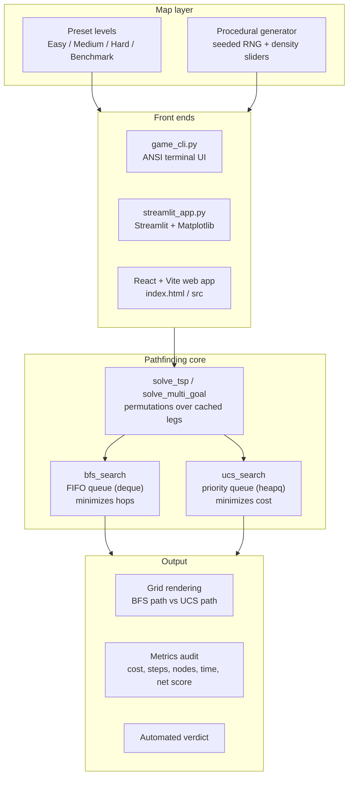
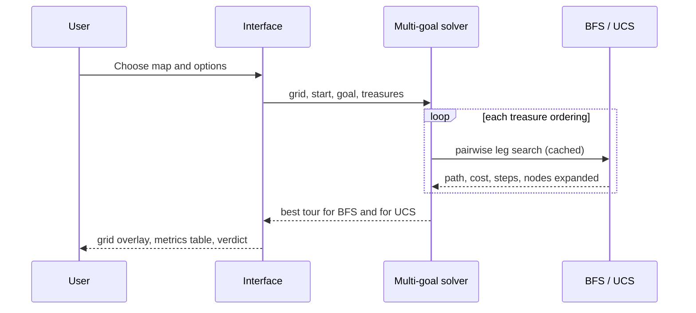

#  BFS vs UCS Pathfinding Simulator

An interactive simulator that compares **Breadth-First Search (BFS)** and **Uniform Cost Search (UCS)** on weighted terrain grids with treasures, obstacles, and an automated performance audit.

BFS finds the path with the fewest **steps**. UCS finds the path with the lowest **total movement cost**. On uniform grids they agree, but once terrain has different costs (mud, water) they diverge, and this project shows exactly how and why.

The repo ships **three front ends** over the same core idea:

| Interface | File(s) | Dependencies | Best for |
|---|---|---|---|
|  Terminal CLI | `game_cli.py` | None (Python stdlib only) | Quick demo, zero setup |
|  Streamlit app | `streamlit_app.py` | streamlit, numpy, matplotlib, pandas | Data-science style dashboard |
|  Web app | `index.html`, `src/` (React + Vite) | Node.js | Polished interactive UI |

---

##  Features

- **Two algorithms, side by side**: BFS (hop-optimal) vs UCS (cost-optimal)
- **Weighted terrain**: Grass (1), Mud (3), Water (5), Obstacle (blocked)
- **Treasure hunt mode**: visit every treasure, then reach the goal. The best visiting order is found by trying all permutations over cached pairwise legs
- **Preset levels**: Easy (Meadow Crossing 8×8), Medium (Swamp Shortcut Trap 10×10), Hard (Archipelago & Straits 12×12); the Streamlit app also has the Triple Corridor benchmark
- **Procedural / custom maps**: seeded random terrain, with adjustable mud, water and obstacle density in the Streamlit app
- **Performance audit**: total cost, step count, nodes expanded, execution time, net score (treasure points minus cost)
- **Automated verdict**: a plain-language explanation of why one algorithm won, or why they tied

---

##  Quick Start

### Prerequisites

- Python 3.8+ (CLI and Streamlit)
- Node.js 18+ and npm (web app only)

### 1. Terminal CLI (no install needed)

```bash
python3 game_cli.py
```

Pick a map `[1-4]` (Easy / Medium / Hard / Random). The CLI prints a color-coded grid, a metrics table, and the verdict.

### 2. Streamlit app

```bash
# (optional) create a virtual environment
python3 -m venv .venv
source .venv/bin/activate          # Windows: .venv\Scripts\activate

pip install -r requirements.txt
streamlit run streamlit_app.py
```

Then open the URL Streamlit prints (usually http://localhost:8501).

### 3. Web app (React + Vite)

```bash
npm install
cp .env.example .env               # then edit .env if you use Gemini features
npm run dev
```

Open http://localhost:3000.

Other scripts:

```bash
npm run build      # production build to dist/
npm run preview    # serve the production build locally
npm run lint       # TypeScript type-check (tsc --noEmit)
npm run clean      # remove dist/ and server.js
```

> **Environment variables** (`.env`): `GEMINI_API_KEY` and `APP_URL` are only needed for Gemini-powered features. They are injected automatically when running inside Google AI Studio. Never commit your real `.env` file (it is already in `.gitignore`).

---

##  Terrain Legend

| Symbol | Terrain | Cost |
|---|---|---|
| `.` | Grass | 1 |
| `~` | Mud | 3 |
| `=` | Water | 5 |
| `#` | Obstacle | Blocked |

Movement is 4-directional (up, right, down, left).

---

##  Architecture



### How a run works



### Key design points

- **BFS** uses `collections.deque` and marks nodes visited on enqueue. It optimizes the number of hops and ignores terrain cost, so its path can be expensive.
- **UCS** uses a `heapq` priority queue keyed by cumulative cost `g(n)`, with lazy deletion of stale entries. It is guaranteed optimal for non-negative costs.
- **Multi-goal tours**: every treasure ordering is evaluated with `itertools.permutations`, and pairwise leg results are memoized so each leg is searched once. BFS picks the ordering with the fewest steps; UCS picks the one with the lowest cost.
- **Net score** = total treasure points − total movement cost.

### Complexity

| | Time | Notes |
|---|---|---|
| BFS (single leg) | O(V + E) | V = cells, E ≈ 4V |
| UCS (single leg) | O((V + E) log V) | binary heap |
| Multi-goal tour | O(k!) orderings over O(k²) cached legs | k = number of treasures, so keep k small |

---

##  Project Structure

```
.
├── game_cli.py          # Pure-Python terminal simulator
├── streamlit_app.py     # Streamlit dashboard
├── requirements.txt     # Python deps for Streamlit app
├── index.html           # Web app entry (loads /src/main.tsx)
├── src/                 # React + TypeScript source
├── package.json         # Node scripts and dependencies
├── vite.config.ts       # Vite + React + Tailwind config
├── tsconfig.json        # TypeScript config
├── metadata.json        # AI Studio app metadata
├── .env.example         # Environment variable template
└── .gitignore
```

---

##  Tech Stack

- **Python**: `heapq`, `collections.deque`, `itertools`, `time`
- **Streamlit, NumPy, Matplotlib, pandas**: dashboard, grid math, plotting, tables
- **React 19, TypeScript, Vite, Tailwind CSS v4**: web UI
- **motion, lucide-react**: animation and icons
- **@google/genai**: optional Gemini integration

---

##  References

1. Russell, S. & Norvig, P. *Artificial Intelligence: A Modern Approach* (4th ed.), Chapter 3: Solving Problems by Searching.
2. Dijkstra, E. W. (1959). *A note on two problems in connexion with graphs.* Numerische Mathematik, 1, 269–271.
3. Cormen, T. et al. *Introduction to Algorithms* (CLRS): BFS and shortest paths chapters.
4. [Breadth-first search](https://en.wikipedia.org/wiki/Breadth-first_search): Wikipedia
5. [Dijkstra's algorithm / Uniform-cost search](https://en.wikipedia.org/wiki/Dijkstra%27s_algorithm): Wikipedia
6. [Red Blob Games: Introduction to the A* Algorithm](https://www.redblobgames.com/pathfinding/a-star/introduction.html): excellent visual explanation of BFS, Dijkstra/UCS and A*

---


